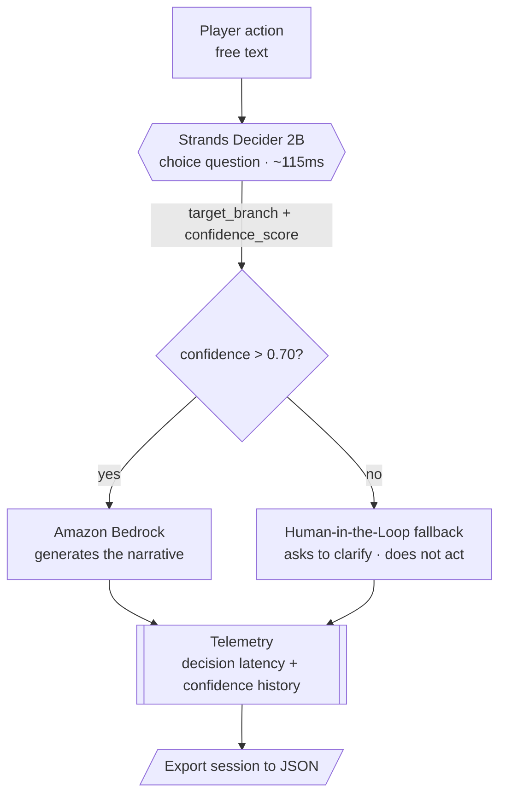

# ChronosDecider: The Narrative Time Weaver

### A real-time RPG Game Master that knows when it doesn't know

[](LICENSE)
[](https://www.python.org/)
[](tests/)
[](#requirements)
[](https://github.com/strands-labs/strands-decider)
[](https://aws.amazon.com/bedrock/)

ChronosDecider is an ultra-fast Game Master for real-time RPGs: it turns every player action into a calibrated narrative decision. Strands Decider 2B picks the story branch with a confidence it can measure in milliseconds, and Amazon Bedrock narrates it. When confidence drops below the threshold, the agent does not improvise: it fires a Human-in-the-Loop guardrail and asks for clarification. A decision engine that separates deciding from generating, with live latency and confidence telemetry.

> Submission for the **Agent Experience Hackathon: Strands Decider**.
> Decision pattern demonstrated: **Tool selection** (`#tool-selection`).
> Tags: `#strands-decider-2b` `#tool-selection`
>
> Repository: https://github.com/LucioD3v/ChronosDecider

## The idea in one sentence

The player types an action in natural language. **Decider 2B** uses a typed
`choice` question to pick which narrative branch (tool) applies and with what
confidence. If confidence is high, **Bedrock** generates the narration for that
branch. If it is low (`<= 0.70`), the agent **does not make things up**: it asks
the player to clarify (Human-in-the-Loop).

This is the key separation of concerns, aligned with the model's design
([Strands Decider does not generate text](https://github.com/strands-labs/strands-decider)):

| Component | Role | Produces |
| --- | --- | --- |
| **Strands Decider 2B** | Decision | `choice` (branch) + `confidence_score` |
| **Amazon Bedrock** | Generation | Game Master narrative text |
| **ChronosDecider engine** | Orchestration | Triage/fallback, validation, telemetry |

## Architecture



- **Decision** (Strands Decider 2B): picks the branch, generates no text.
- **Generation** (Amazon Bedrock): narrates only when the decision is reliable.
- **Guardrail**: confidence `<= 0.70` ⇒ no narration, clarification is requested.

## Technology stack

| Layer | Technology | Why |
| --- | --- | --- |
| Decision | **Strands Decider 2B** (open source, Apache-2.0) | Calibrated `choice` in ~115ms, no text generation |
| Generation | **Amazon Bedrock** (`us-east-1`, Converse API) | Game Master narration only when the decision is reliable |
| Transport to Decider | **Python `urllib`** (stdlib) | Calls the local `/v1/systemone` server with zero extra deps |
| AWS SDK | **boto3** (optional) | Invokes Bedrock; absent ⇒ local template narrator |
| Orchestration, telemetry, UI, tests | **Python 3.10+ standard library** | No external runtime dependencies |

## Requirements

- **Python 3.10+** (tested with 3.14).
- For real decisions: the `strands-decider` package (open source, Apache-2.0).
- For real generation: an **AWS account with Amazon Bedrock** enabled in
  `us-east-1`, plus `boto3`.

The project **runs without either of them** thanks to simulated backends, for
local development and so anyone can run the demo. See below.

---

## Enabling Strands Decider 2B

Strands Decider 2B is **not a managed AWS service**: it is an open-source model
published on Hugging Face (the [`StrandsAgents`](https://huggingface.co/StrandsAgents)
organization, mirrored under [`amazon`](https://huggingface.co/amazon)) under the
Apache-2.0 license. It runs locally on CPU, a consumer GPU, or Apple Silicon.
There is nothing to "enable" in the AWS console; you install and run it.

Steps (per the [official repository guide](https://github.com/strands-labs/strands-decider)):

**1. Install the model CLI**

```bash
pip install strands-decider
```

**2. Try a typed `choice` decision** (the first run downloads the weights from
Hugging Face):

```bash
strands-decider ask StrandsAgents/strands-decider-2B-qwen3.5-v1-2610 \
  --state "I attack the goblin with my sword" \
  --choice "Which narrative branch?=combat,dialogue,exploration,flee,interaction"
```

The output is the chosen option with its calibrated confidence, e.g.
`choice_0 -> combat (confidence 0.83)`.

**3. Start the local HTTP server** (what ChronosDecider consumes):

```bash
strands-decider serve StrandsAgents/strands-decider-2B-qwen3.5-v1-2610 --port 8000
```

This exposes `POST http://localhost:8000/v1/systemone`. ChronosDecider sends the
state (the player's action) and a `choice` question, and receives the branch +
confidence.

> Hardware note: the reference checkpoint (`...-2B-qwen3.5-v1-2610`) has 1.9B
> parameters and serves on CPU; on GPU the median latency is around ~115ms. On
> Apple Silicon use the MLX extra. See the official guide for details.

By default ChronosDecider points to `http://localhost:8000`. Override it with the
`CHRONOS_DECIDER_URL` environment variable.

---

## Enabling Amazon Bedrock (us-east-1)

Bedrock **does** need to be configured in your AWS account. Console steps:

1. Sign in to the **AWS console** and select the **US East (N. Virginia) `us-east-1`** region (top right).
2. Go to **Amazon Bedrock → Model access**.
3. Click **Enable specific models** / **Manage model access** and **enable** the
   generative model you plan to use (for example an Anthropic Claude or Amazon
   Nova model available in your account). Approval is usually immediate.
4. Create credentials with permission to invoke Bedrock. Minimal IAM policy:

   ```json
   {
     "Version": "2012-10-17",
     "Statement": [{
       "Effect": "Allow",
       "Action": ["bedrock:InvokeModel"],
       "Resource": "*"
     }]
   }
   ```

5. Configure the credentials in your environment (one of these):

   ```bash
   aws configure            # default profile, region us-east-1
   # or environment variables:
   # setx AWS_ACCESS_KEY_ID ...    (Windows / PowerShell)
   # setx AWS_SECRET_ACCESS_KEY ...
   # setx AWS_DEFAULT_REGION us-east-1
   ```

6. Tell ChronosDecider which model to use (exact id of the enabled model):

   ```bash
   # PowerShell
   setx CHRONOS_BEDROCK_MODEL_ID "<enabled-model-id>"
   setx CHRONOS_BEDROCK_REGION  "us-east-1"
   ```

> If you do not configure Bedrock, ChronosDecider falls back to a local template
> narrator so the demo keeps working; the narrative is simpler but the flow is
> identical.

---

## Project structure

```
ChronosDecider/
├── main.py                       # Interactive console RPG demo
├── src/
│   ├── config.py                 # Thresholds, region, model ids, endpoints
│   ├── engine/                   # Decision + orchestration
│   │   ├── decider_client.py     # Strands Decider client (real HTTP + simulated)
│   │   ├── narrator.py           # Generation via Amazon Bedrock (+ local fallback)
│   │   ├── schema_validator.py   # Strict validation against narrative_schema.json
│   │   └── decision_engine.py    # decide → triage → narrate → validate → telemetry
│   ├── telemetry/                # Per-decision latency + confidence history
│   └── ui/                       # RPG demo + real-time metrics panel
├── decision_patterns/            # Reusable decision pattern (deliverable)
├── scripts/
│   └── benchmark.py              # Latency and confidence-distribution benchmark
├── tests/                        # unittest suite (no external dependencies)
└── .kiro/steer/                  # Architecture and schema (read at runtime)
```

## Running the demo

```bash
python main.py
```

Execution mode depends on what you have configured:

- **Nothing configured**: simulated Decider + template narrator. Fully functional for trying the flow.
- **With `strands-decider serve` running**: real model decisions.
- **With Bedrock configured**: real generated narrative.

Type actions like `attack the goblin`, `talk to the merchant`, `explore the
cave`. Ambiguous actions trigger clarification (Human-in-the-Loop).

**In-demo commands:**

| Command | Action |
| --- | --- |
| `help` / `ayuda` / `?` | Show help and examples. |
| `export` / `exportar` | Save the current session's metrics to a JSON file. |
| `quit` / `exit` / `salir` | End the demo. |

## Exporting telemetry

During the demo, the `export` command writes a JSON with the aggregated summary
and the full session history (per-turn latency and confidence, with timestamps):

```
[EXPORT] Session metrics saved to: .../chronosdecider_telemetry_<stamp>.json
```

Programmatically:

```python
engine.telemetry.export_json("telemetry.json")   # or .to_dict() for a dict
```

## Benchmark

Measures decision latency and confidence distribution with the deterministic
simulated backend (no model server or Bedrock required):

```bash
python scripts/benchmark.py            # text report (1000 iterations)
python scripts/benchmark.py -n 5000    # custom iteration count
python scripts/benchmark.py --json     # JSON output for CI/dashboards
```

It reports mean/min/max and **p50/p90/p95/p99** latency percentiles, the
percentage within the `<100ms` target, a `confidence_score` histogram, and the
percentage of turns that triggered the fallback.

## Tests

```bash
python -m unittest discover -s tests -p "test_*.py" -v
```

## Reusable decision pattern

The hackathon's reusable deliverable lives in
[`decision_patterns/`](decision_patterns/): the typed question, the wiring to put
it in an agent's path, and a usage note. Pattern: **tool selection**.

## License

Apache-2.0 (see [LICENSE](LICENSE)). Strands Decider 2B is also Apache-2.0.
