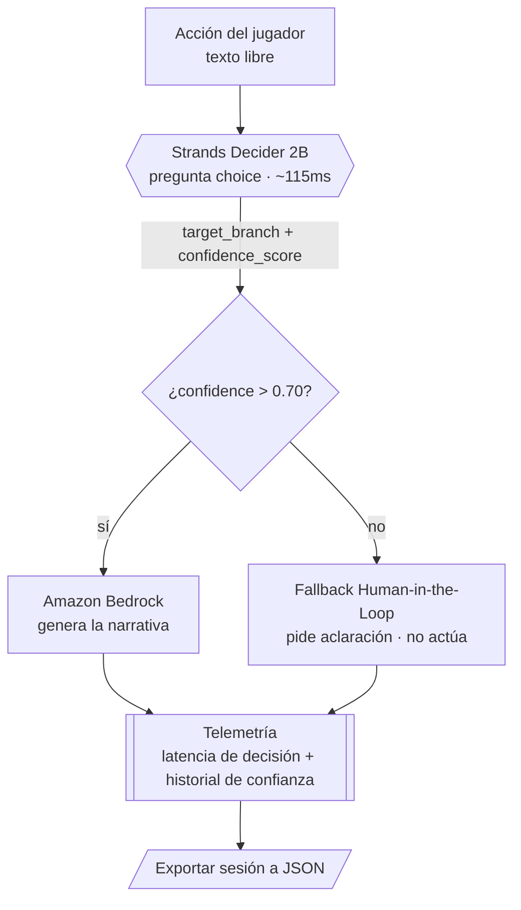

# ChronosDecider

[](LICENSE)
[](https://www.python.org/)
[](tests/)
[](#requisitos)
[](https://github.com/strands-labs/strands-decider)
[](https://aws.amazon.com/bedrock/)

ChronosDecider es un Game Master ultrarrapido para RPG en tiempo real: convierte cada accion del jugador en una decision narrativa calibrada. Strands Decider 2B elige la rama de la historia con una confianza medible en milisegundos, y Amazon Bedrock la narra. Cuando la confianza baja del umbral, el agente no improvisa: activa un guardrail Human-in-the-Loop y pide aclaracion. Motor de decision que separa decidir de generar con telemetria de latencia y certeza viva.

> Submission para la **Agent Experience Hackathon: Strands Decider**.
> Patrón de decisión demostrado: **Tool selection** (`#tool-selection`).
> Tags: `#strands-decider-2b` `#tool-selection`

## La idea en una frase

El jugador escribe una acción en lenguaje natural. **Decider 2B** elige, con una
pregunta tipada `choice`, qué rama/herramienta narrativa corresponde y con qué
confianza. Si la confianza es alta, **Bedrock** genera la narración de esa rama.
Si es baja (`<= 0.70`), el agente **no inventa**: pide aclaración al jugador
(Human-in-the-Loop).

Esta es la separación de responsabilidades clave, alineada con el diseño del
modelo ([Strands Decider no genera texto](https://github.com/strands-labs/strands-decider)):

| Pieza | Rol | Produce |
| --- | --- | --- |
| **Strands Decider 2B** | Decisión | `choice` (rama) + `confidence_score` |
| **Amazon Bedrock** | Generación | Texto narrativo del Game Master |
| **Motor ChronosDecider** | Orquestación | Triage/fallback, validación, telemetría |

## Arquitectura



- **Decisión** (Strands Decider 2B): elige la rama, no genera texto.
- **Generación** (Amazon Bedrock): narra solo cuando la decisión es fiable.
- **Guardrail**: confianza `<= 0.70` ⇒ no se narra, se pide aclaración.

## Requisitos

- **Python 3.10+** (probado con 3.14).
- Para la decisión real: el paquete `strands-decider` (open source, Apache-2.0).
- Para la generación real: una cuenta de **AWS con Amazon Bedrock** habilitado en
  `us-east-1` y `boto3`.

El proyecto **arranca sin ninguna de las dos** gracias a backends simulados, para
desarrollo local y para que cualquiera pueda ejecutar la demo. Ver más abajo.

---

## Activar Strands Decider 2B

Strands Decider 2B **no es un servicio gestionado de AWS**: es un modelo de código
abierto publicado en Hugging Face (organización
[`StrandsAgents`](https://huggingface.co/StrandsAgents), con espejo en
[`amazon`](https://huggingface.co/amazon)) bajo licencia Apache-2.0. Corre en local
sobre CPU, GPU de consumo o Apple Silicon. No hay que "activarlo" en la consola de
AWS; se instala y se ejecuta.

Pasos (según la [guía oficial del repositorio](https://github.com/strands-labs/strands-decider)):

**1. Instalar el CLI del modelo**

```bash
pip install strands-decider
```

**2. Probar una decisión tipada `choice`** (la primera vez descarga los pesos desde
Hugging Face):

```bash
strands-decider ask StrandsAgents/strands-decider-2B-qwen3.5-v1-2610 \
  --state "Ataco al goblin con mi espada" \
  --choice "¿Qué rama narrativa?=combat,dialogue,exploration,flee,interaction"
```

La salida es la opción elegida con su confianza calibrada, p. ej.
`choice_0 -> combat (confidence 0.83)`.

**3. Levantar el servidor HTTP local** (lo que ChronosDecider consume):

```bash
strands-decider serve StrandsAgents/strands-decider-2B-qwen3.5-v1-2610 --port 8000
```

Expone `POST http://localhost:8000/v1/systemone`. ChronosDecider envía el estado
(la acción del jugador) y una pregunta `choice`, y recibe la rama + confianza.

> Nota de hardware: el checkpoint de referencia (`...-2B-qwen3.5-v1-2610`) tiene
> 1.9B parámetros y sirve en CPU; en GPU la latencia mediana ronda los ~115ms.
> En Apple Silicon usa el extra MLX. Detalles en la guía oficial.

Por defecto ChronosDecider apunta a `http://localhost:8000`. Puedes cambiarlo con
la variable de entorno `CHRONOS_DECIDER_URL`.

---

## Activar Amazon Bedrock (us-east-1)

Bedrock **sí** se configura en tu cuenta de AWS. Pasos en la consola:

1. Inicia sesión en la **consola de AWS** y selecciona la región **US East (N. Virginia) `us-east-1`** (arriba a la derecha).
2. Ve a **Amazon Bedrock → Model access** (Acceso a modelos).
3. Pulsa **Enable specific models** / **Manage model access** y **habilita** el
   modelo generativo que vayas a usar (por ejemplo, un modelo de Anthropic Claude o
   Amazon Nova disponible en tu cuenta). La aprobación suele ser inmediata.
4. Crea credenciales con permiso para invocar Bedrock. Política IAM mínima:

   ```json
   {
     "Version": "2012-10-17",
     "Statement": [{
       "Effect": "Allow",
       "Action": ["bedrock:InvokeModel"],
       "Resource": "*"
     }]
   }
   ```

5. Configura las credenciales en tu entorno (una de estas):

   ```bash
   aws configure            # perfil por defecto, región us-east-1
   # o variables de entorno:
   # setx AWS_ACCESS_KEY_ID ...    (Windows / PowerShell)
   # setx AWS_SECRET_ACCESS_KEY ...
   # setx AWS_DEFAULT_REGION us-east-1
   ```

6. Indica a ChronosDecider qué modelo usar (id exacto del modelo habilitado):

   ```bash
   # PowerShell
   setx CHRONOS_BEDROCK_MODEL_ID "<id-del-modelo-habilitado>"
   setx CHRONOS_BEDROCK_REGION  "us-east-1"
   ```

> Si no configuras Bedrock, ChronosDecider usa un narrador local de plantilla para
> que la demo siga funcionando; la narrativa será más simple pero el flujo es el mismo.

---

## Estructura del proyecto

```
ChronosDecider/
├── main.py                       # Demo RPG interactiva por consola
├── src/
│   ├── config.py                 # Umbrales, región, ids de modelo, endpoints
│   ├── engine/                   # Decisión + orquestación
│   │   ├── decider_client.py     # Cliente Strands Decider (HTTP real + simulado)
│   │   ├── narrator.py           # Generación con Amazon Bedrock (+ fallback local)
│   │   ├── schema_validator.py   # Validación estricta contra narrative_schema.json
│   │   └── decision_engine.py    # decidir → triage → narrar → validar → telemetría
│   ├── telemetry/                # Latencia por decisión + historial de confianza
│   └── ui/                       # Demo RPG + panel de métricas en tiempo real
├── decision_patterns/            # Patrón de decisión reutilizable (entregable)
├── scripts/
│   └── benchmark.py              # Benchmark de latencia y distribución de confianza
├── tests/                        # Suite unittest (sin dependencias externas)
└── .kiro/steer/                  # Arquitectura y esquema (leídos en runtime)
```

## Ejecutar la demo

```bash
python main.py
```

Modo de ejecución según lo que tengas configurado:

- **Sin nada configurado**: Decider simulado + narrador de plantilla. Funciona al 100% para probar el flujo.
- **Con `strands-decider serve` activo**: decisiones reales del modelo.
- **Con Bedrock configurado**: narrativa generada real.

Escribe acciones como `atacar al goblin`, `hablar con el mercader`, `explorar la
cueva`. Las acciones ambiguas disparan la aclaración (Human-in-the-Loop).

**Comandos dentro de la demo:**

| Comando | Acción |
| --- | --- |
| `ayuda` / `help` / `?` | Muestra la ayuda y ejemplos. |
| `export` / `exportar` | Guarda las métricas de la sesión actual en un archivo JSON. |
| `salir` / `quit` / `exit` | Termina la demo. |

## Exportar telemetría

Durante la demo, el comando `export` escribe un JSON con el resumen agregado y el
historial completo de la sesión (latencia y confianza por turno, con timestamps):

```
[EXPORT] Métricas de la sesión guardadas en: .../chronosdecider_telemetry_<stamp>.json
```

Programáticamente:

```python
engine.telemetry.export_json("telemetria.json")   # o .to_dict() para un dict
```

## Benchmark

Mide latencia de decisión y distribución de confianza con el backend simulado
determinista (no requiere servidor del modelo ni Bedrock):

```bash
python scripts/benchmark.py            # reporte de texto (1000 iteraciones)
python scripts/benchmark.py -n 5000    # nº de iteraciones personalizado
python scripts/benchmark.py --json     # salida JSON para CI/dashboards
```

Reporta media/mín/máx y percentiles **p50/p90/p95/p99** de latencia, el
porcentaje dentro del objetivo `<100ms`, un histograma del `confidence_score` y
el porcentaje de turnos que activaron el fallback.

## Tests

```bash
python -m unittest discover -s tests -p "test_*.py" -v
```

## Patrón de decisión reutilizable

El entregable reutilizable de la hackathon está en
[`decision_patterns/`](decision_patterns/): la pregunta tipada, el wiring para
meterla en la ruta de un agente, y una nota de uso. Patrón: **tool selection**.

## Licencia

Apache-2.0 (ver [LICENSE](LICENSE)). Strands Decider 2B también es Apache-2.0.
