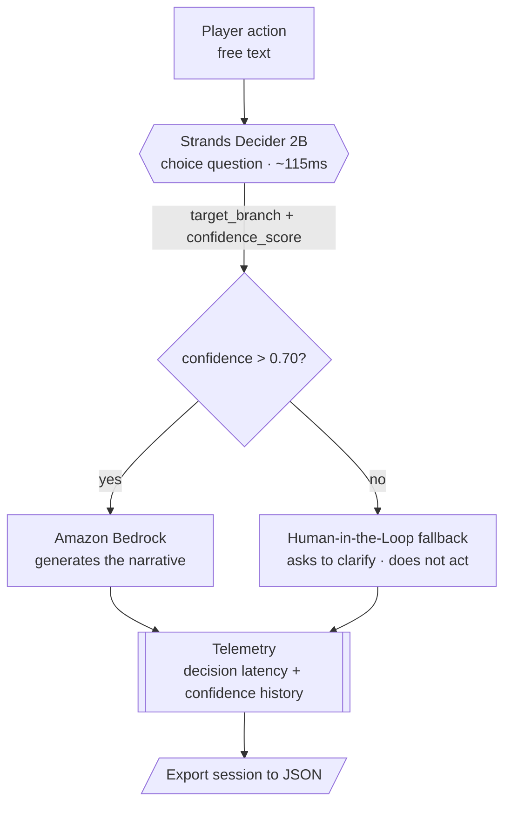

# ChronosDecider: The Narrative Time Weaver

### A real-time RPG Game Master that knows when it doesn't know

**Tags:** `#strands-decider-2b` `#tool-selection`

## TL;DR

ChronosDecider is a real-time text RPG where **Strands Decider 2B picks the story branch** and **Amazon Bedrock narrates it**. Every player action is a fresh decision. When Decider's calibrated confidence drops below a threshold, the agent refuses to improvise and asks the player to clarify instead. The result: a Game Master that is fast, grounded, and honest about uncertainty.

## The problem

Text RPGs live or die on responsiveness. Every turn, the engine has to answer one question: is this action combat, dialogue, exploration, a retreat, or an object interaction? That is a routing decision, not a writing task.

If you hand that decision to a generative LLM, you pay for it three times: in latency (you wait for tokens you don't need), in cost (you burn a full generation on a classification), and in reliability (an LLM will confidently route a vague action to *something*, because generating a plausible answer is what it does). Players feel the lag and the wrong turns.

## The idea: separate deciding from narrating

ChronosDecider splits the agent's work along the line the tools are actually good at.

- **Strands Decider 2B makes the decision.** It receives the player's action as state and a typed `choice` question whose options are the five narrative branches. It returns one branch and a **calibrated confidence score** — no text, one forward pass.
- **Amazon Bedrock does the generation.** Once a branch is chosen with enough confidence, Bedrock writes the Game Master's narration for that branch.
- **The confidence score is the guardrail.** If Decider's confidence is at or below `0.70`, the agent does **not** narrate. It triggers a Human-in-the-Loop fallback and asks the player to rephrase. This is only possible because Decider exposes a calibrated confidence that a generative API does not.

| Component | Role | Output |
| --- | --- | --- |
| Strands Decider 2B | Decision | branch choice + confidence |
| Amazon Bedrock | Generation | Game Master narration |
| ChronosDecider engine | Orchestration | triage, validation, telemetry |

## Architecture



If the diagram above does not render, here is the same flow in plain text:

```
Player action
      |
      v
Strands Decider 2B  (choice question, ~115ms)
      |  -> target_branch + confidence_score
      v
confidence > 0.70 ?
   |                     |
  yes                    no
   v                     v
Amazon Bedrock      Human-in-the-Loop fallback
(narrates)          (asks to clarify, does not act)
   |                     |
   +----------+----------+
              v
       Telemetry (decision latency + confidence history)
              v
       Export session to JSON
```

## Technology stack

| Layer | Technology | Why |
| --- | --- | --- |
| Decision | **Strands Decider 2B** (open source, Apache-2.0) | Calibrated `choice` in ~115ms, no text generation |
| Generation | **Amazon Bedrock** (`us-east-1`, Converse API) | Game Master narration only when the decision is reliable |
| Transport to Decider | **Python `urllib`** (stdlib) | Calls the local `/v1/systemone` server with zero extra deps |
| AWS SDK | **boto3** (optional) | Invokes Bedrock; absent ⇒ local template narrator |
| Orchestration, telemetry, UI, tests | **Python 3.10+ standard library** | No external runtime dependencies |

Design principle: **the model server and Bedrock are both optional**. With neither
configured, ChronosDecider runs on deterministic local fallbacks so anyone can try
the flow; wire in the real Decider server and Bedrock and the same code path lights up.

## The decision I handed to Decider 2B

A single `choice` question, asked every turn:

> *"Given the player's action, which narrative branch applies?"*
> options: `combat, dialogue, exploration, flee, interaction`

This is a **tool-selection** pattern: the chosen branch is the "tool" the agent runs next. And it is a **high-frequency** decision — a single play session fires hundreds of these, which is exactly where moving the decision off the LLM pays off in latency and cost.

## The reusable decision pattern

The repository ships a drop-in asset other builders can reuse: `decision_patterns/tool_selection.py`. It is independent of the game and uses only the Python standard library. It provides the three things the challenge asks for:

1. **The typed question and option set** — `build_choice_question(instructions, options)`.
2. **The wiring that puts it in the agent's path** — `ToolSelectionPattern.as_intervention(execute, on_low_confidence)`, a `before_tool_call`-style gate: run the chosen tool only if confidence clears the threshold, otherwise ask for clarification.
3. **A usage note** — in `decision_patterns/README.md`.

Swap the options for your own tool names and it works in any agent. Example — routing a support message:

```python
pattern = ToolSelectionPattern(
    instructions="Which team should handle this message?",
    options=["billing", "sales", "retail"],
    confidence_threshold=0.70,
)
choice = pattern.select(user_message)
if choice.should_act:
    route_to(choice.tool)
else:
    ask_for_clarification()
```

## Results

Decision latency, measured over a benchmark run against the live Decider server:

- Median (p50): `[[fill in — ms]]`
- p95 / p99: `[[fill in]]` / `[[fill in]]`
- Within the sub-100ms target: `[[fill in %]]`
- Fallback (Human-in-the-Loop) rate across mixed inputs: `[[fill in %]]`

`[[Optional but strong: one line comparing this to routing the same decision through a Bedrock LLM call — e.g. "the same routing via a generative call took ~Xms, so Decider cut decision latency by N×."]]`

## What I learned

- **Calibrated confidence changes the design.** It is not a nice-to-have number; it is the signal that lets the agent decide when to act and when to ask. Without it, the "ask instead of guess" behavior would be impossible.
- **Letting each model do its job keeps the system clean and cheap.** Decider routes; Bedrock writes. Neither does the other's work.
- `[[Add one honest, specific observation from running the real model — e.g. how confidence behaved on ambiguous vs. clear actions.]]`

## Try it

Repository: `[[public repo link]]`

```bash
# 1) Serve the decision model
pip install strands-decider
strands-decider serve StrandsAgents/strands-decider-2B-qwen3.5-v1-2610 --port 8000

# 2) (Optional) Enable Amazon Bedrock in us-east-1 and set CHRONOS_BEDROCK_MODEL_ID
# 3) Run the demo
python main.py
```

Without the model server or Bedrock, the demo still runs on local fallback backends so anyone can try the flow.

## Demo video

`[[public video link, under 3 minutes]]`
